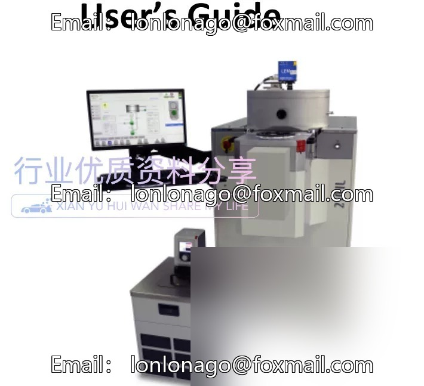
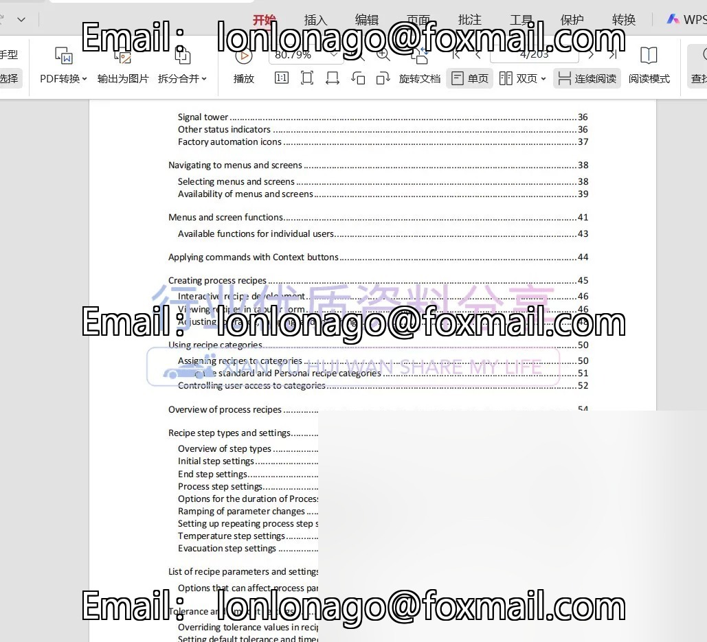
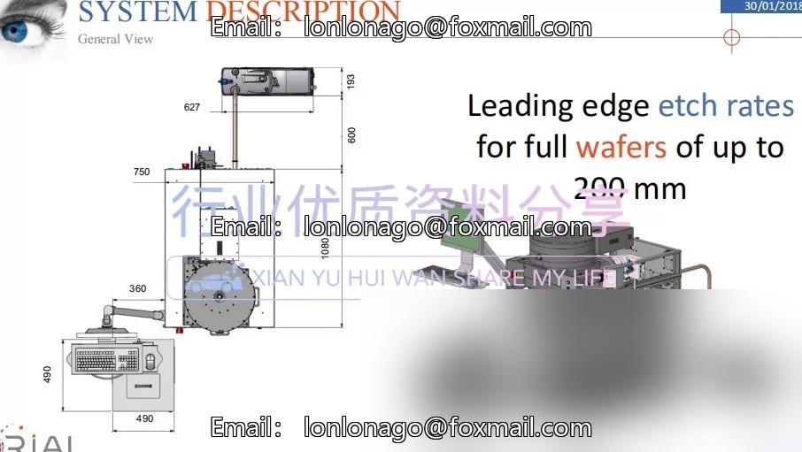
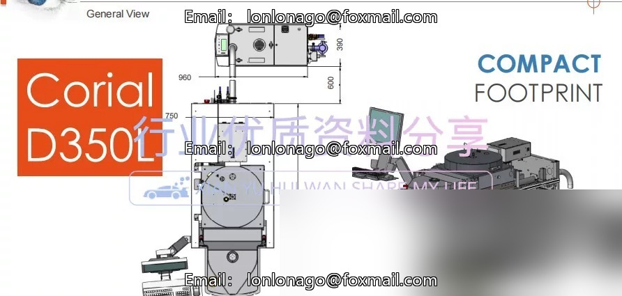
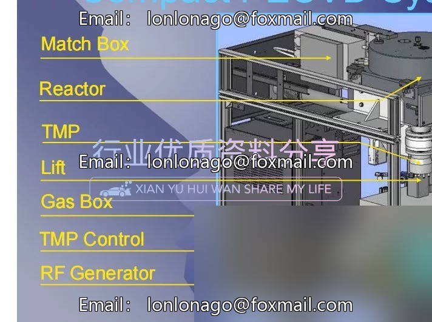
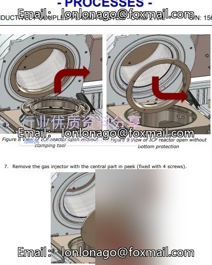

# # PDF dry etching equipment materials: CORiAL, including D250L 35

## Body

# PDF dry etching equipment materials: CORiAL - including technical materials such as D250L 350 and 210, operation manual SOP, etc., with several hundred pages!

Upload directly to for electronic original files! The following image contains a screenshot of the file portion. Please confirm before placing an order! Because electronic file materials are copyable. So after purchase, no return is allowed! Thank you for understanding!

For personal learning and reference use only.

The material covers dry etching equipment, CORiAL-related techniques, operation manuals and SOPs, including tables, icons, status indicators and PDF conversion/viewing details.

<!-- AI_ENRICHED -->

## Images

## Payment

Here is a pay link on Stripe ( https://buy.stripe.com/3cs8yP7sY87d0vu9AB ). Please contact me lonlonago@foxmail.com after funding $89, and I will send you a complete data files , thank you!

